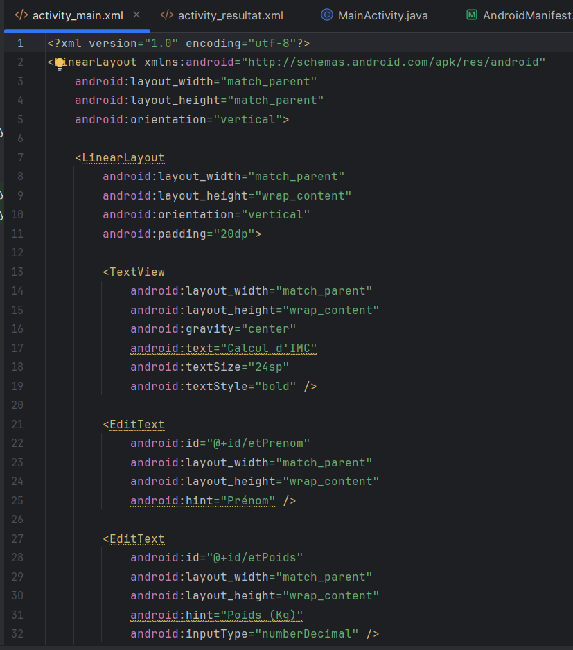

# TP5 - Intents explicites et implicites

## Présentation

Cette application Android calcule l'IMC d'un utilisateur à partir de son prénom, son poids et sa taille. Elle permet de passer de l'activité principale à l'activité de résultat avec un Intent explicite, puis d'ouvrir le composeur téléphonique avec un Intent implicite.

## Objectifs du TP

- Saisir les informations de l'utilisateur : prénom, poids, taille et sexe.
- Calculer l'IMC avec la formule : poids / (taille × taille).
- Afficher le résultat et son interprétation dans une deuxième activité.
- Utiliser un Intent explicite pour ouvrir l'écran de résultat.
- Utiliser un Intent implicite pour ouvrir le composeur avec le numéro 123.

## Captures du code

### Interface principale - `activity_main.xml`



### Interface résultat - `activity_resultat.xml`


### Activité principale - `MainActivity.java`


### Activité résultat - `ResultatActivity.java`


## Résultat final de l'application

### Écran de saisie de l'IMC


### Écran du résultat et interprétation


### Intent implicite - composeur téléphonique


## Organisation des captures

Créer un dossier `captures` à la racine du projet et y placer les captures avec les noms ci-dessus. Les images doivent montrer le code dans Android Studio ou l'application en cours d'exécution.

```text
captures/
├── code-activity-main.png
├── code-activity-resultat.png
├── code-main-activity.png
├── code-resultat-activity.png
├── resultat-saisie.png
├── resultat-imc.png
└── resultat-appel.png
```

## Exécution

1. Ouvrir le projet dans Android Studio.
2. Lancer l'application sur un émulateur ou un appareil Android.
3. Saisir les informations et appuyer sur **CALCULER**.
4. Vérifier l'affichage du résultat et de son interprétation.
5. Appuyer sur **Appeler 123** pour ouvrir le composeur téléphonique.

## Auteur

- Nom et prénom : à compléter
- Filière / groupe : LSI3
- Année universitaire : 2026-2027
